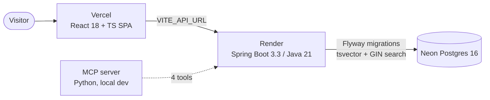

# IncidentVault — Live Demo Deployment Plan ($0/month)

Goal: a public, clickable live demo URL. This is the single highest-ROI portfolio
upgrade: it feeds the GitHub README (live badge), LinkedIn Featured section, and
resume bullets all at once. "Unfinished side projects are common. Running ones
are rare."

## Recommended stack (all free tier)

| Piece | Choice | Why |
|---|---|---|
| Postgres | **Neon** free tier | Permanent free tier, **no credit card required**. Real Postgres (tsvector + GIN indexes work). 0.5 GB storage, 100 compute-hours/mo, scales to zero. Plenty for seed data + demo traffic. |
| Backend (Spring Boot) | **Render** free web service, Docker deploy | $0. Deploys straight from the existing `backend/Dockerfile`. Sleeps after ~15 min idle (30–60s cold start on first hit — fine for a demo). |
| Frontend (Vite SPA) | **Vercel** (or Cloudflare Pages) | Free static hosting, deploys from GitHub. |

Why not Fly.io: their free tier ("3 free VMs") was sunset for new organizations
around Oct 2024 — new signups are pay-as-you-go with a card required. Railway
likewise has no recurring free tier ($5/mo minimum). Render free + Neon free +
Vercel free = $0 with no card.

## Code changes needed before deploying (small, all verified against the repo)

1. **CORS** — the backend has no CORS configuration (verified: no
   `CorsConfiguration`/`@CrossOrigin` anywhere). In docker-compose the nginx
   frontend proxies `/api/` same-origin, but a split deployment (Vercel SPA →
   Render API) is cross-origin and browsers will block it. Add:
   ```java
   @Configuration
   public class CorsConfig implements WebMvcConfigurer {
     @Value("${CORS_ALLOWED_ORIGINS:*}")
     private String allowedOrigins;
     @Override
     public void addCorsMappings(CorsRegistry registry) {
       registry.addMapping("/api/**")
           .allowedOrigins(allowedOrigins.split(","))
           .allowedMethods("GET", "POST", "PUT", "DELETE", "OPTIONS");
     }
   }
   ```
   Set `CORS_ALLOWED_ORIGINS=https://<your-vercel-app>.vercel.app` in Render env.

2. **JVM heap** — Render free = 512 MB RAM. The Dockerfile's
   `ENTRYPOINT ["java", "-jar", ...]` sets no heap flags and (exec form) can't
   expand env vars. Change to:
   ```dockerfile
   ENTRYPOINT ["sh", "-c", "java ${JAVA_OPTS:-} -jar /app/incidentvault-0.1.0.jar"]
   ```
   Then set `JAVA_OPTS=-XX:MaxRAMPercentage=75.0` as a Render env var
   (~384 MB heap — comfortable for this app).

3. **Frontend API URL** — `frontend/src/api/client.ts` already reads the
   build-time var `VITE_API_URL` (falls back to `http://localhost:8080` for local
   dev). On Vercel, set `VITE_API_URL=https://<render-service>.onrender.com`.
   No code change needed.

4. **Database** — backend already reads `DATABASE_URL` / `DATABASE_USER` /
   `DATABASE_PASSWORD` from env, Flyway auto-runs `V1__schema.sql` +
   `V2__seed.sql` on first boot (`ddl-auto: validate`). In Neon, copy the
   **pooled** connection string and append `?sslmode=require`; split it into the
   three env vars on Render.

5. **API key** — `API_KEY` is unset by default (open API). For a portfolio demo
   that anyone can click, simplest is to leave it open; traffic will be
   negligible. If spam ever appears, set `API_KEY` on Render (writes then need
   `X-API-Key`) — the frontend would need the header added at that point.

6. **Health check** — `/actuator/health` is already exposed. Use it as Render's
   health check path.

## Deploy steps

1. **Neon** — sign up (no card) → new project → copy the pooled connection
   string. Region: pick the one closest to your Render region (Oregon is a
   safe default for a Seattle audience).
2. **Render** — sign up → New → Web Service → connect the
   `BhagyashriT/incidentvault` repo → Docker runtime, dockerfile path
   `./backend/Dockerfile` → set env vars (`DATABASE_URL`, `DATABASE_USER`,
   `DATABASE_PASSWORD`, `JAVA_OPTS`, `CORS_ALLOWED_ORIGINS`) → health check
   path `/actuator/health` → Deploy. First boot takes several minutes (Maven
   build + Flyway migrations + seed). Note the public URL.
3. **Vercel** — import the same repo → root directory `frontend/` → build
   command `npm run build`, output `dist/` → env var
   `VITE_API_URL=https://<render-service>.onrender.com` → Deploy.
4. **Smoke test** (do this before announcing it anywhere):
   - `GET https://<render>/actuator/health` → `{"status":"UP"}`
   - `GET https://<render>/api/incidents?q=redis` → seeded incidents return
   - `GET https://<render>/api/runbooks?q=failover` → seeded runbooks return
   - Open the Vercel URL: search works, incident detail + timeline render,
     new-incident form submits (if writes left open).
   - Cold-start check: wait 20 min idle, reload — first paint may take ~60s.
     Put "first load may take a minute (free tier)" in the README so it reads
     as intentional, not broken.
5. **README + profile updates**:
   - Add a `[](https://<vercel-url>)`
     badge at the top of the repo README, plus a "Live demo" section.
   - Add the architecture diagram below (GitHub renders Mermaid).
   - LinkedIn Featured → link the demo. Resume → "Deployed live demo" bullet.

## Architecture



## Cost, limits, and honesty notes

- $0/month total as specced. If the demo ever exceeded Neon's 100 CU-hours/mo,
  compute suspends until next month (data is safe) — acceptable for a demo.
- Render free sleeps when idle; Neon scales to zero. Both wake on traffic.
- `docker-compose.yml` stays the local-dev path; nothing here replaces it.
- Rollback: Render → redeploy any previous commit from the dashboard. DB:
  Neon branching lets you test migrations on a copy first.

## What this proves (for interviews)

"Built and operate a full-stack system end-to-end: containerized Spring Boot
API on Render, serverless Postgres on Neon with full-text search, CI-built
React SPA on Vercel, Flyway-managed schema, health checks, CORS, and JVM
tuning for a 512 MB container — all for $0/month." That is a startup-shaped
0→1 story, and it's yours to tell because you actually did it.
