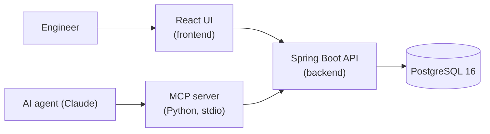

# IncidentVault

A shared incident-knowledge service: engineers and AI agents search prior
incidents, read their timelines, log evidence, validated root causes, and
fixes, and reuse runbooks instead of re-investigating from scratch. A Spring
Boot + PostgreSQL API stores incident investigations with full-text search;
a React UI gives engineers a searchable timeline view; a Python MCP server
exposes the same knowledge base as tools so an AI agent (e.g. Claude) can
pull validated troubleshooting steps mid-incident.

## Architecture



- **Engineer path:** the React UI (served by nginx, proxies `/api/` to the
  backend) calls the Spring Boot REST API, which reads/writes PostgreSQL
  (full-text search via generated `tsvector` columns + GIN indexes).
- **Agent path:** the MCP server speaks MCP over stdio to the agent and
  plain HTTP to the Spring Boot API — same data, same contract, no UI.

## Repo layout

```
incidentvault/
├── backend/            # Spring Boot 3.3 / Java 21 REST API (Flyway migrations, 21 tests)
├── mcp-server/         # Python MCP server (stdio) exposing incident knowledge as tools
├── frontend/           # React 18 + TypeScript + Vite UI, nginx reverse-proxy Dockerfile
├── docker-compose.yml  # Postgres 16 + backend + frontend (nginx)
└── README.md           # this file
```

Each workstream has its own README (`backend/README.md`,
`mcp-server/README.md`, `frontend/README.md`) with deeper detail.

## Prerequisites

- Java 21 (Maven wrapper `./mvnw` is included in `backend/`)
- Node 24+, npm 10+
- Python 3.12+
- Docker + Docker Compose (for the compose path only)

## Quickstart

### Option A — Docker Compose (everything)

```bash
docker compose up --build
```

- App: http://localhost:3000
- API: http://localhost:8080/api
- Postgres: localhost:5432

### Option B — run the pieces locally

Backend (needs Postgres at `localhost:5432`, e.g. via Docker):

```bash
docker run --name iv-postgres -e POSTGRES_USER=incidentvault \
  -e POSTGRES_PASSWORD=incidentvault -e POSTGRES_DB=incidentvault \
  -p 5432:5432 -d postgres:16
cd backend
./mvnw spring-boot:run   # Flyway applies V1 schema + V2 seed data automatically
```

Frontend (needs the backend running):

```bash
cd frontend
npm install
npm run dev              # serves at http://localhost:5173
```

### MCP server setup

```bash
cd mcp-server
pip install -r requirements.txt
```

Then paste the `incidentvault` block from `mcp-server/mcp.json.example` into
the `mcpServers` object of your Claude Desktop config (macOS:
`~/Library/Application Support/Claude/claude_desktop_config.json`),
**replacing `/ABSOLUTE/PATH/TO/server.py` with the absolute path to this
repo's `mcp-server/server.py`**, and restart Claude Desktop. Point at a
non-local backend with the `INCIDENTVAULT_API_URL` env var in that config.

## API endpoints (all under `/api`)

| Method | Endpoint | What it does |
|---|---|---|
| GET | `/incidents?q=&severity=&service=&status=` | List incidents (newest first); `q` is full-text search |
| POST | `/incidents` | Create an incident (`title`, `severity`, `service`, optional `status`, `startedAt`, `summary`) |
| GET | `/incidents/{id}` | Full detail: timeline, log snippets, root causes, fixes, linked runbooks |
| PATCH | `/incidents/{id}` | Update `status`, `severity`, `summary`, or `resolvedAt` |
| POST | `/incidents/{id}/timeline` | Append a timeline event (`actor`, `type`, `message`) |
| GET | `/incidents/{id}/timeline` | Timeline events ordered by timestamp |
| POST | `/incidents/{id}/logs` | Attach a log snippet (`source`, `snippet`) |
| POST | `/incidents/{id}/root-causes` | Record a root-cause hypothesis (`validated?`, `evidence?`) |
| POST | `/incidents/{id}/fixes` | Record a fix (`description`, optional `prUrl`, `commitSha`) |
| GET | `/runbooks?q=` | List runbooks (id, title, linked incident ids); `q` searches title + steps |
| POST | `/runbooks` | Create a runbook with ordered steps (optional linked incident ids) |
| GET | `/runbooks/{id}` | Runbook steps plus linked incidents |
| POST | `/runbooks/{id}/link/{incidentId}` | Link a runbook to an incident |

Errors use a consistent envelope: `{"error": "..."}` — 404 for unknown ids,
400 for validation errors. Optional API-key auth via the `X-API-Key` header
when `API_KEY` is set (see `backend/README.md`).

## MCP tools

| Tool | What it does |
|---|---|
| `search_incidents` | Search incidents by query, with optional severity/service filters; compact results |
| `get_incident` | Full incident detail: timeline, root causes (validated vs. unvalidated), fixes, linked runbooks |
| `get_runbook` | Look up the best-matching runbook and return its numbered steps with commands |
| `add_timeline_event` | Append a note/action/alert to an incident's timeline |

### Example MCP session (illustrative)

> **You:** we have a redis latency spike in checkout, what do we know?
>
> **Agent:** *(calls `search_incidents("redis latency spike", service="checkout-api")`)*
> Found one match: **"Checkout latency spike - Redis failover misconfig"**
> (P1, RESOLVED). *(calls `get_incident(1)`)*
> The validated root cause was a Sentinel failover policy referencing a
> decommissioned primary — clients kept routing to a dead node until the
> config was corrected. *(calls `get_runbook("redis failover")`)*
> There's a linked runbook, **"Redis failover verification"**, with numbered
> verification steps. Summary of validated fix steps:
> 1. Confirm the Sentinel failover policy points at a live primary
>    (no decommissioned endpoints).
> 2. Verify client routing recovers within the SLO after the config change.
> 3. Run the post-incident verification checklist from the runbook.

## Seed data

Flyway migration `V2__seed.sql` loads realistic sample data on first start:

- **Incident 1** — "Checkout latency spike - Redis failover misconfig"
  (P1, RESOLVED, service `checkout-api`): a scheduled Redis failover went
  wrong because Sentinel referenced a decommissioned primary endpoint.
- **Incident 2** — "Kafka consumer lag after broker restart"
  (P2, MITIGATED, service `order-events`): consumer group fell 500k+
  messages behind after `kafka-02` restarted during a rolling OS patch.
- **Incident 3** — "Connection pool exhaustion in payments service"
  (P3, RESOLVED, service `payments-api`): the HikariCP web pool saturated
  because a nightly settlement batch held connections while blocked on a
  slow fraud-check API.

Each incident ships with 5 timeline events (15 total), log snippets, a
validated root cause, and a fix. Two runbooks are seeded and linked to
incidents: **"Redis failover verification"** and
**"Kafka consumer lag triage"**.

## Testing / verification

- Backend: `21 tests green` — `cd backend && ./mvnw test` (repository +
  MockMvc web-layer integration tests, running on H2). The full-text
  `tsvector` search path targets real PostgreSQL (dialect-aware search
  service with a portable fallback for tests), so do one smoke pass
  against a real Postgres (e.g. the compose stack) before demoing.
- Frontend: `npm run build` clean, zero TypeScript errors.
- MCP server: imports and lists all 4 tools (`search_incidents`,
  `get_incident`, `get_runbook`, `add_timeline_event`).
- `docker-compose.yml` is provided, but it could not be executed on this
  machine (no Docker daemon here) — it's a standard three-service stack,
  worth one local `docker compose up --build` before any demo.

## Configuration

| Variable | Default | Used by |
|---|---|---|
| `DATABASE_URL` | `jdbc:postgresql://localhost:5432/incidentvault` | backend — JDBC URL |
| `DATABASE_USER` | `incidentvault` | backend — DB user |
| `DATABASE_PASSWORD` | `incidentvault` | backend — DB password |
| `API_KEY` | _(empty — auth disabled)_ | backend — enables the `X-API-Key` placeholder filter (`incidentvault.api-key`) when set |
| `VITE_API_URL` | `http://localhost:8080` | frontend — API base URL at build/dev time (compose path uses the nginx `/api/` proxy instead) |
| `INCIDENTVAULT_API_URL` | `http://localhost:8080` | mcp-server — backend base URL |

(Spring's relaxed binding also accepts `SPRING_DATASOURCE_URL`,
`SPRING_DATASOURCE_USERNAME`, and `SPRING_DATASOURCE_PASSWORD` in place of
the `DATABASE_*` trio.)

## Resume bullets

* Designed and built IncidentVault, a full-stack incident-knowledge platform (Spring Boot 3, PostgreSQL 16, React 18, MCP) that stores incident timelines, log evidence, validated root causes, fixes, and runbooks so engineers and AI agents reuse prior investigations instead of repeating them.
* Implemented PostgreSQL full-text search (tsvector generated columns + GIN indexes, plainto_tsquery/ts_rank) across incidents and runbooks with severity/service/status filtering, backed by a dialect-aware search service with a portable fallback for tests.
* Built an MCP server (Python) exposing incident search, full incident retrieval, runbook lookup, and timeline writes as tools, enabling Claude/AI agents to pull validated troubleshooting steps mid-incident — shipped with a Claude Desktop config and demo session.
* Shipped the schema via Flyway versioned migrations (seeded with realistic data: 3 incidents, 15 timeline events, 2 runbooks), containerized with Docker Compose (Postgres 16 + backend + frontend/nginx), and kept a 21-test suite (repository + MockMvc web-layer integration tests) green on every build.
* Delivered a React + TypeScript UI (Vite) with incident search/filter, vertical timeline visualization, RCA evidence view, and runbook viewer — deliberate design tokens, zero template residue.
* Defined a 13-endpoint REST API contract up front (validation, consistent 404/400 error envelopes, API-key placeholder filter), letting backend, MCP, and frontend workstreams build in parallel against one contract.

## Push to GitHub

Manual step (the coordinator owns this — do not run from an agent session
without credentials):

```
cd ~/workspace/incidentvault
git init -b main
git add -A
git commit -m "Initial commit: IncidentVault MVP"
gh repo create incidentvault --public --source=. --push
# or, without gh: create the repo on github.com, then:
# git remote add origin git@github.com:<you>/incidentvault.git
# git push -u origin main
```
